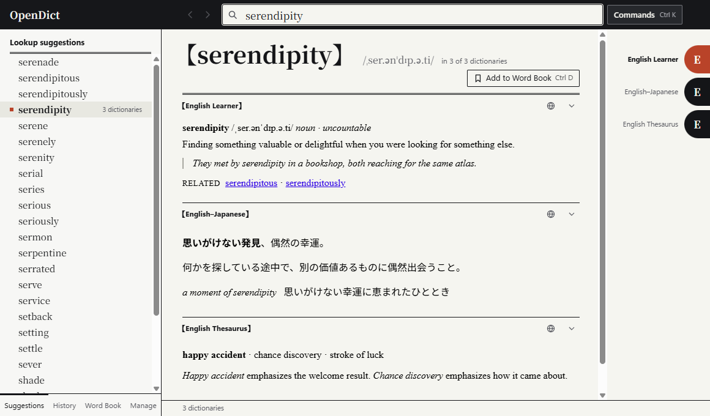
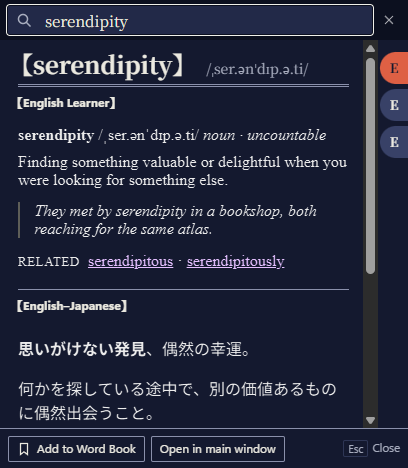
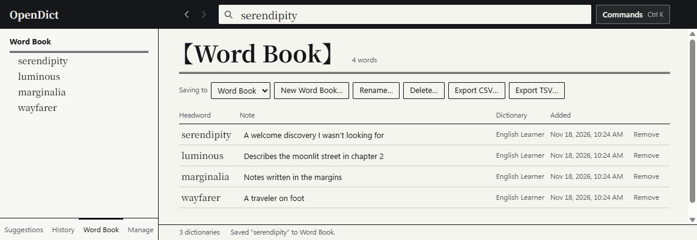

<p align="center">
  
</p>
<h1 align="center">OpenDict</h1>
<p align="center">
  An open-source desktop reader for your local MDict dictionaries.<br>
  Look up a word once and read every matching entry on one page, in its original layout.
</p>
<p align="center">
  <a href="https://github.com/amemiya02/OpenDict/releases/latest"><strong>Download OpenDict</strong></a>
  · <a href="#quick-start">Quick start</a>
  · <a href="README.zh-CN.md" lang="zh-CN">简体中文</a>
</p>
<p align="center">
  <a href="https://github.com/amemiya02/OpenDict/releases/latest"></a>
  <a href="https://github.com/amemiya02/OpenDict/actions/workflows/ci.yml"></a>
  <a href="LICENSE"></a>
  <a href="#install"></a>
</p>

[](docs/screenshots/lookup.png)

<p align="center"><sub>OpenDict on Windows with sample dictionaries.</sub></p>

## Install

Download the package for your system from [the latest release](https://github.com/amemiya02/OpenDict/releases/latest).

| System | Package |
| --- | --- |
| Windows (x64) | Run the `.exe` installer. |
| macOS (Apple silicon or Intel) | Open the matching `.dmg` and drag OpenDict to Applications. |
| Linux (x64) | Make the `.AppImage` executable with `chmod +x`, or install the `.deb` on a Debian-based distribution. |

On startup, OpenDict checks for updates and offers **Install and restart** when one is available. On Linux, in-app updates are available for the AppImage.

<details>
<summary>First launch on Windows or macOS</summary>

The installers are currently unsigned. If you downloaded yours from the official release page and the system prompts you, follow the steps for your platform.

- **Windows** · In SmartScreen, select **More info**, then **Run anyway**.
- **macOS** · Open **System Settings → Privacy & Security** and select **Open Anyway** for OpenDict.

</details>

## Quick start

1. Open **Manage → Add folder…** and choose a folder containing your `.mdx` files. Keep companion `.mdd` files beside them. OpenDict indexes the files in place and ships without dictionaries.
2. Type a word in the search box. Use **↑** and **↓** to move through suggestions and **Enter** to look up the selected word.
3. Click a dictionary in the right-hand index to jump to its entry. Open **Commands** with **Ctrl+K** (**⌘K** on macOS) to change settings or run common actions.

You can group dictionaries by language or task, search with wildcards, revisit lookup history, and switch between light and dark themes. Your library, history, and saved words stay on your device.

## While you read

### Look up selected text in the Mini Window

Select a word in another app and press the **Look up the selection** shortcut. OpenDict shows the result beside the selection. Press **Esc** to return to your reading. Find or change the shortcut under **Manage → Mini Window**.

<p align="center">
  
</p>

### Save words and notes

Use **Add to Word Book** to keep a word. The **Word Book** tab lets you organize saved words into named books, add notes, and export to CSV or TSV.

[](docs/screenshots/word-book.png)

## Develop

Install stable Rust, Node.js 24 or later, and the [Tauri prerequisites](https://v2.tauri.app/start/prerequisites/) for your system. Clone the repository and generate a sample library to try the app.

```bash
git clone https://github.com/amemiya02/OpenDict.git
cd OpenDict
cargo run --locked -p opendict-mdict-fixture --example sample_library -- sample-library
cd apps/desktop
npm ci
```

Start the app from `apps/desktop`.

**macOS or Linux**

```bash
OPENDICT_LIBRARY_FOLDER="$(cd ../../sample-library && pwd)" npm run tauri -- dev
```

**Windows PowerShell**

```powershell
$env:OPENDICT_LIBRARY_FOLDER = (Resolve-Path '../../sample-library').Path
npm.cmd run tauri -- dev
```

Run the interface checks and build it before running the Rust workspace tests.

```bash
npm run lint
npm test
npm run build
cargo test --workspace --locked
```

## Contribute

Report bugs or discuss changes in [GitHub Issues](https://github.com/amemiya02/OpenDict/issues). Include the OpenDict version, operating system, and steps to reproduce. Use the sample generator when a test needs dictionary data.

- [Roadmap](docs/roadmap.md)
- [Design system](DESIGN.md)
- [Release process](docs/releasing.md)

## License

OpenDict is licensed under [GPL-3.0-or-later](LICENSE). The MDict parser in [`crates/mdict`](crates/mdict) is dual-licensed under MIT or Apache-2.0. [License boundary](docs/adr/0001-gpl-app-permissive-parser.md)
