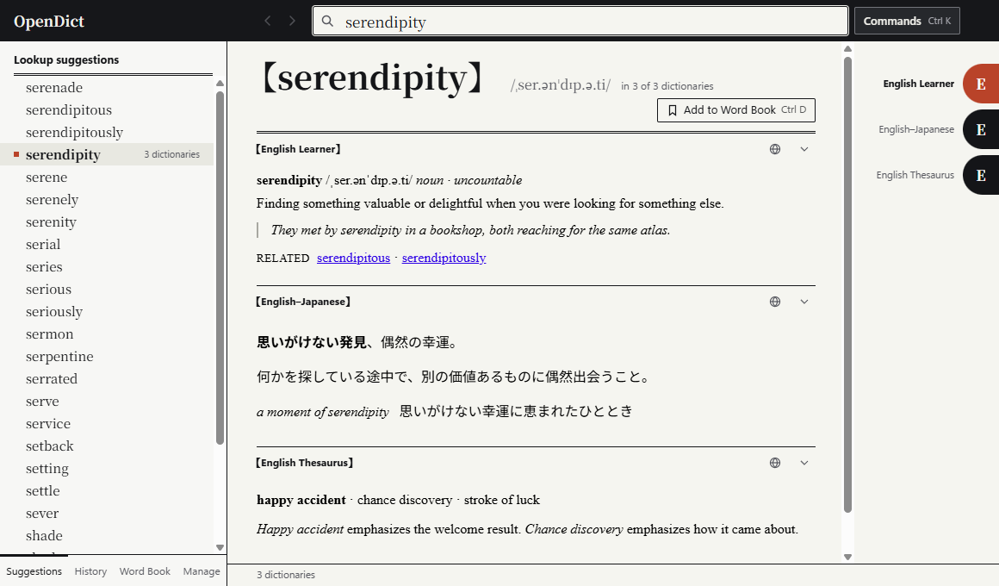
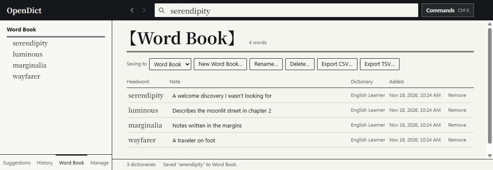

<p align="center">
  
</p>
<h1 align="center">OpenDict</h1>
<p align="center">
  用自己的 MDict 词库查词的开源桌面应用。<br>
  一次查询，在同一页对照多本词典的释义，保留各自的原有排版。
</p>
<p align="center">
  <a href="https://github.com/amemiya02/OpenDict/releases/latest"><strong>下载 OpenDict</strong></a>
  · <a href="#快速上手">快速上手</a>
  · <a href="README.md" lang="en">English</a>
</p>
<p align="center">
  <a href="https://github.com/amemiya02/OpenDict/releases/latest"></a>
  <a href="https://github.com/amemiya02/OpenDict/actions/workflows/ci.yml"></a>
  <a href="LICENSE"></a>
  <a href="#安装"></a>
</p>

[](docs/screenshots/lookup.png)

<p align="center"><sub>Windows 版 OpenDict 与示例词典。</sub></p>

## 安装

从[最新 Release](https://github.com/amemiya02/OpenDict/releases/latest) 下载适合你系统的安装包。

| 系统 | 安装方式 |
| --- | --- |
| Windows（x64） | 运行 `.exe` 安装程序。 |
| macOS（Apple 芯片或 Intel） | 打开对应的 `.dmg`，将 OpenDict 拖入「应用程序」。 |
| Linux（x64） | 对 `.AppImage` 执行 `chmod +x` 后运行，或在 Debian 系发行版上安装 `.deb`。 |

OpenDict 启动时会检查更新。有新版本时，点击「安装并重新启动」即可升级。Linux 上可在 AppImage 版本中使用应用内更新。

<details>
<summary>Windows 和 macOS 首次打开</summary>

目前的安装包没有代码签名。从官方发布页下载安装包后，如果系统出现提示，可以按以下方式打开。

- **Windows** · 在 SmartScreen 中点击「更多信息」，然后选择「仍要运行」。
- **macOS** · 在「系统设置 → 隐私与安全性」中为 OpenDict 选择「仍要打开」。

</details>

## 快速上手

1. 打开「词库与设置 → 添加文件夹…」，选择存放 `.mdx` 文件的目录。配套的 `.mdd` 文件放在同一目录。OpenDict 会原地建立索引，应用本身不附带词典。
2. 在搜索框输入词头。按 **↑** 或 **↓** 切换联想词，按 **Enter** 查词。
3. 点击右侧索引中的词典可跳到对应释义。点击「命令」或按 **Ctrl+K**（macOS 为 **⌘K**），可以搜索设置和常用操作。

你还可以按语言或用途给词典分组、用通配符查词、查看历史记录和切换浅色或深色主题。词库、历史记录和生词都保存在本机。

## 阅读时怎么用

### 在迷你窗口查选中的词

在其他应用中选中一个词，按「查询选中的文字」快捷键，释义会出现在迷你窗口中。按 **Esc** 回到原处。可在「词库与设置 → 迷你窗口」查看和修改快捷键。

<p align="center">
  
</p>

### 保存生词和笔记

点击「加入生词本」即可收藏当前词。可在「生词本」里创建多个词本、为词条写笔记，或导出为 CSV 和 TSV。

[](docs/screenshots/word-book.png)

## 开发

安装 Rust 稳定版、Node.js 24 或更新版本，以及对应系统的 [Tauri 前置依赖](https://v2.tauri.app/zh-cn/start/prerequisites/)。克隆项目后，可生成示例词库试用。

```bash
git clone https://github.com/amemiya02/OpenDict.git
cd OpenDict
cargo run --locked -p opendict-mdict-fixture --example sample_library -- sample-library
cd apps/desktop
npm ci
```

在 `apps/desktop` 中启动应用。

**macOS 或 Linux**

```bash
OPENDICT_LIBRARY_FOLDER="$(cd ../../sample-library && pwd)" npm run tauri -- dev
```

**Windows PowerShell**

```powershell
$env:OPENDICT_LIBRARY_FOLDER = (Resolve-Path '../../sample-library').Path
npm.cmd run tauri -- dev
```

运行前端检查并完成构建后，再运行 Rust 工作区测试。

```bash
npm run lint
npm test
npm run build
cargo test --workspace --locked
```

## 参与贡献

欢迎到 [GitHub Issues](https://github.com/amemiya02/OpenDict/issues) 报告问题或讨论改进。报告问题时，请附上 OpenDict 版本、操作系统和复现步骤。需要词典数据的测试可以使用示例词库生成器。

- [项目路线图](docs/roadmap.md)
- [设计系统](DESIGN.md)
- [发布流程](docs/releasing.md)

## 许可证

OpenDict 采用 [GPL-3.0-or-later](LICENSE)。[`crates/mdict`](crates/mdict) 中的 MDict 解析库采用 MIT 或 Apache-2.0 双许可证。 [许可证说明](docs/adr/0001-gpl-app-permissive-parser.md)
